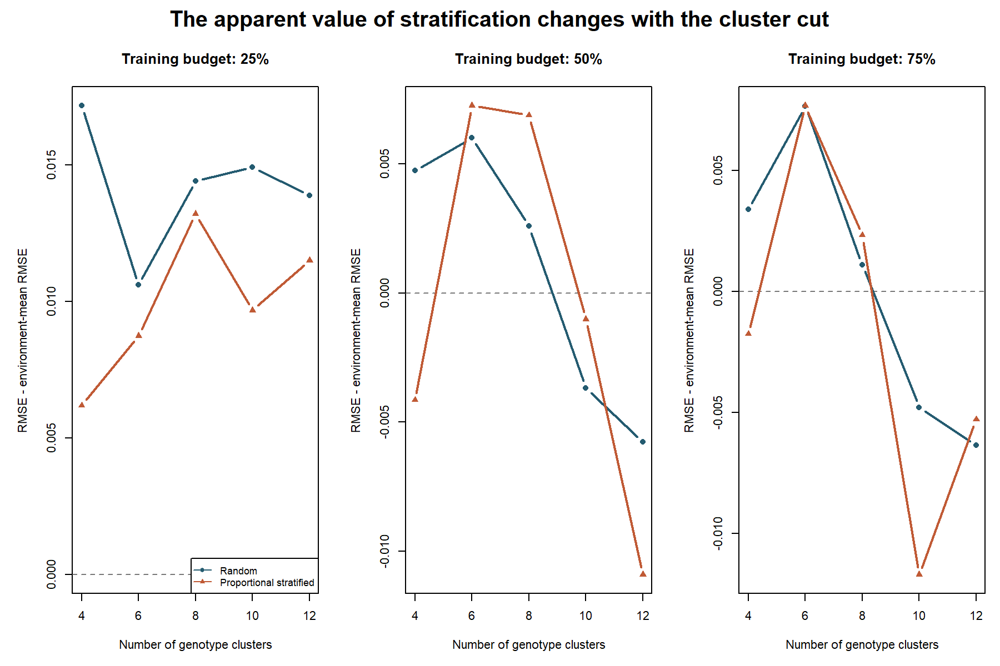

# Rice genomic selection: a decision-focused portfolio analysis

This project evaluates genomic prediction and genotype-diversity sampling for selecting rice lines to phenotype across an uneven multi-environment panel. It demonstrates a reproducible workflow for data provenance, genotype/phenotype quality checks, globally grouped validation, training-only model tuning, breeding decision metrics, and sensitivity analysis.

## Executive result

The public dataset contains 107 lines, 882 polymorphic SNPs, 15 environments, and 1,061 unique line-environment records. In the primary eight-cluster nested line-holdout analysis, the tuned genomic kernel did not improve equal-environment RMSE over an environment-mean benchmark at the 25%, 50%, or 75% candidate budgets. Other cluster cuts produced favorable stratified comparisons for selected outcomes, so no sampling strategy is a robust universal winner. Duplicate-key handling had little effect. Uncertainty intervals resample only 15 environments and are exploratory.

These are retrospective results from published adjusted phenotypes. They are not prospective genetic gain, commercial validation, or evidence about any specific company's breeding material. The project's value is its transparent decision workflow and careful interpretation.

## Quick start in RStudio

The publisher's source supplements are deliberately not stored in this repository. From the project root:

1. Install the required R packages once: `install.packages(c("data.table", "digest"))`.
2. Download the source supplements and write their checksums: `source("R/01_download_source_data.R")`.
3. Run the complete analysis and recreate reports and figures: `source("R/12_run_full_analysis.R")`.

Open `rice-genomic-selection-thesis.Rproj` first. The full pipeline runs the data audit and preparation, baseline analyses, nested model selection, environment bootstrap, duplicate sensitivity, cluster-count sensitivity, and portfolio figure generation. Scripts use fixed random seeds and write paths relative to the project root.

## Repository map

- `R/`: RStudio analysis scripts. See `R/12_run_full_analysis.R` for the ordered workflow.
- `data/raw/README.md`: publisher source, attribution, and download details. Raw files are downloaded locally and gitignored.
- `data/source_manifest.csv`: provenance and SHA-256 checksums for the source files used for the reported run.
- `reports/README.md`: report index. Begin with `reports/portfolio_case_study.md`.
- `results/`: compact tracked summary CSVs and portfolio figures; detailed per-repeat outputs are recreated locally.
- `THESIS_PLAN.md`: thesis framing, study plan, and current progress.

## Validation safeguards

- Each outer split holds out entire genotype lines across all environments.
- Model structure and ridge penalty are chosen by inner folds grouped by line, using training lines only.
- Environment-level outcomes are averaged equally, with paired bootstrap intervals across trials.
- Reports include correlation and RMSE alongside top-20% overlap and selection regret.
- Sensitivity checks cover duplicate phenotype keys and cluster counts 4, 6, 8, 10, and 12.
- Clusters are algorithmic sampling strata, not asserted biological groups.
- The adjusted phenotype table is mostly BLUP-based; no plot-level heritability or realized prospective gain is inferred.

## Project positioning

The source paper already analyzes this same panel with several model and validation designs. This repository presents a reproducible, decision-focused re-evaluation, not a claim that training-population optimization is new or that one method will generalize to commercial programs. The focused literature review and boundary of the contribution are in `reports/literature_positioning.md`.

## Source and reuse

Nguyen et al. (2023), [*Multi-environment genomic selection in rice elite breeding lines*](https://doi.org/10.1186/s12284-023-00623-6). Consult the article and data terms before redistributing the supplementary files. The project downloads these files locally and does not commit them.
